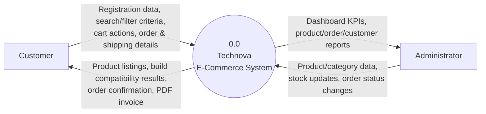
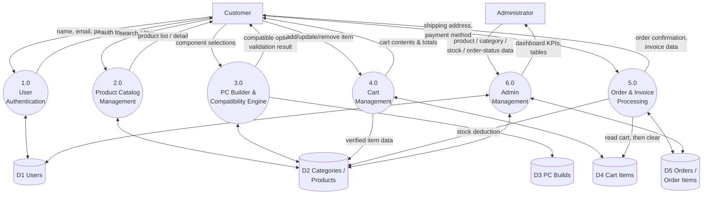
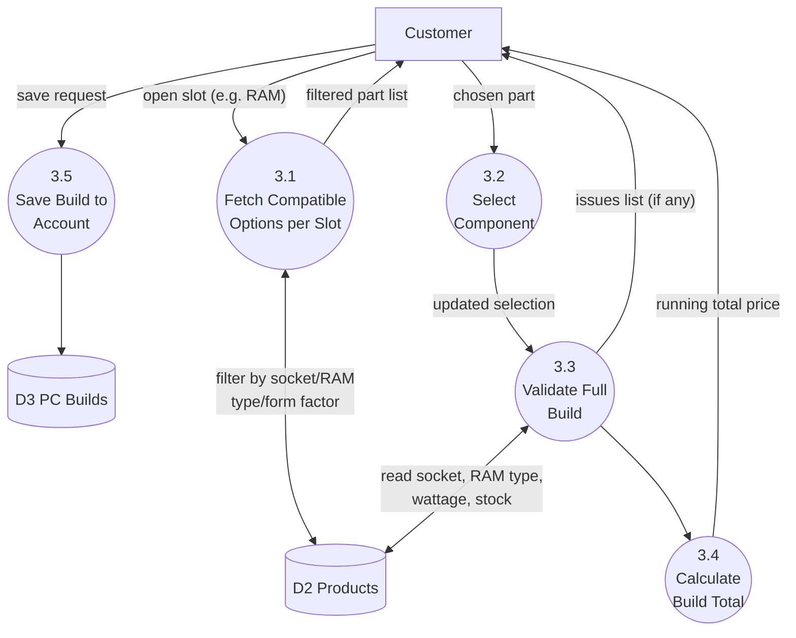
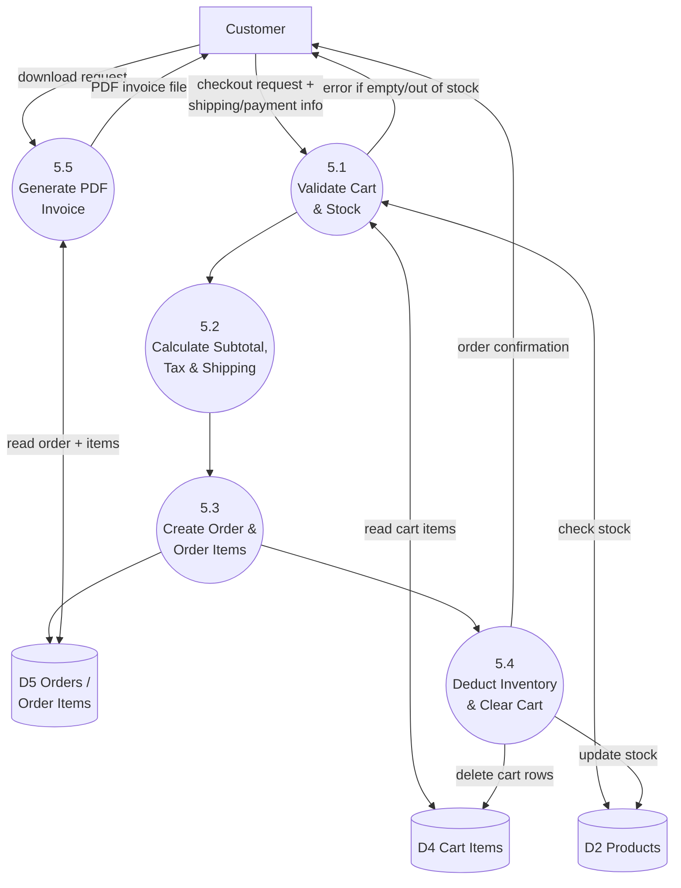
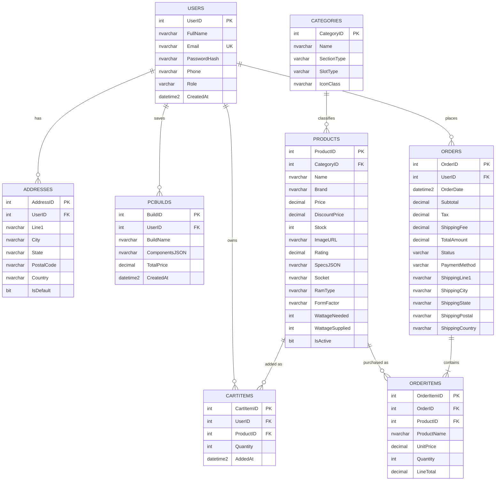
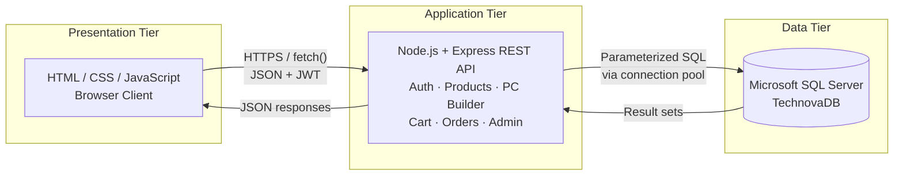
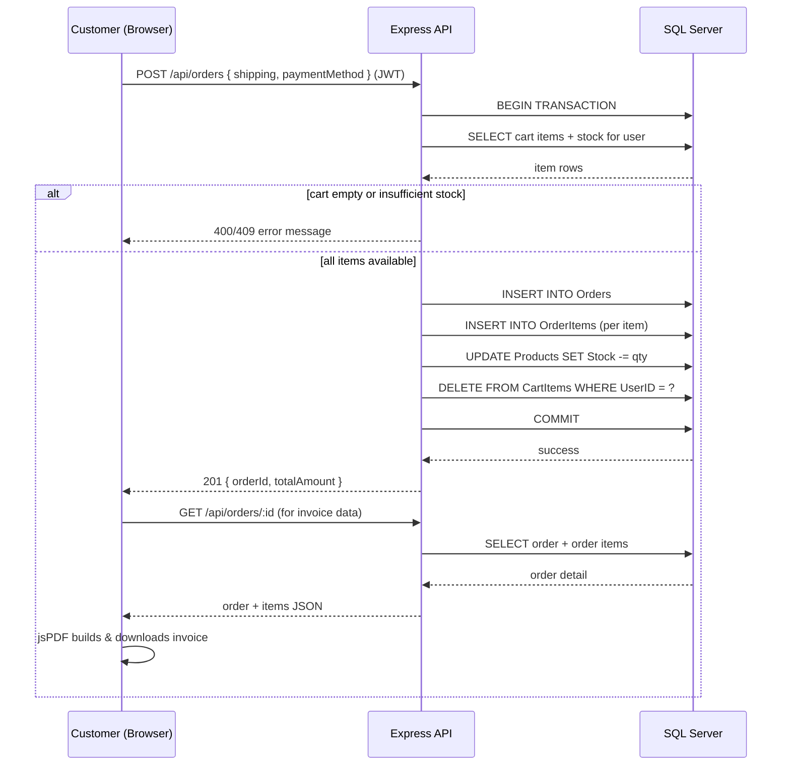
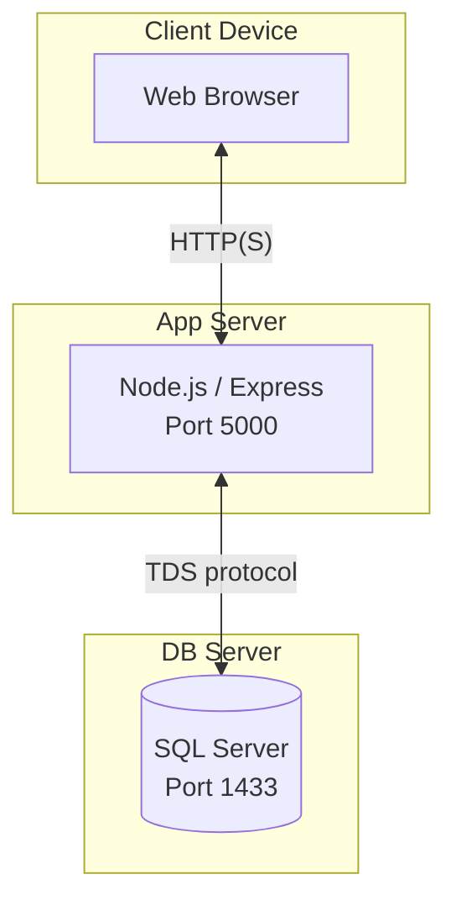

# Technova — Requirement Analysis & System Design Document
### PC Building & CCTV E-Commerce Platform

---

## 1. Introduction

Technova is a two-in-one e-commerce platform that lets customers (a) buy individual PC components with a guided, compatibility-checked builder, and (b) buy CCTV/security equipment for homes, offices and shops — all through one account, one cart and one checkout. This document covers requirement analysis, Data Flow Diagrams (Level 0–2), the ER diagram and database design, and the overall system design.

---

## 2. Requirement Analysis

### 2.1 Stakeholders / User Classes

| User Class | Description |
|---|---|
| **Guest** | Unregistered visitor; can browse and search products but cannot buy |
| **Customer** | Registered user; can build PCs, buy products, manage cart/orders, download invoices |
| **Administrator** | Manages catalog, categories, inventory, orders and customers |

### 2.2 Functional Requirements

| ID | Module | Requirement |
|---|---|---|
| FR-01 | Authentication | System shall allow a guest to register with name, email, phone and password |
| FR-02 | Authentication | System shall authenticate registered users via email + password and issue a session token |
| FR-03 | Catalog | System shall let users browse products by section (PC / CCTV), category, price and search keyword |
| FR-04 | Catalog | System shall display full product detail: specs, price, stock, images, rating |
| FR-05 | PC Builder | System shall let a customer pick one component per slot (CPU, Motherboard, RAM, GPU, Storage, PSU, Cabinet, Monitor) |
| FR-06 | PC Builder | System shall filter each slot's options to only those compatible with prior selections (socket, RAM type, form factor, wattage) |
| FR-07 | PC Builder | System shall validate the complete build and block checkout if any incompatibility or stock issue exists |
| FR-08 | PC Builder | System shall allow a customer to save a build to their account for later |
| FR-09 | Cart | System shall let a customer add, update quantity, and remove products from a persistent cart |
| FR-10 | Checkout | System shall collect a shipping address and payment method, then create an order |
| FR-11 | Checkout | System shall calculate subtotal, tax and shipping, deduct stock, and clear the cart atomically |
| FR-12 | Orders | System shall let a customer view past orders and their status |
| FR-13 | Invoice | System shall generate a downloadable PDF invoice for any completed order |
| FR-14 | Admin | System shall let an admin create, edit and deactivate products and categories |
| FR-15 | Admin | System shall let an admin update stock levels and view low-stock items |
| FR-16 | Admin | System shall let an admin view all orders and update order status |
| FR-17 | Admin | System shall let an admin view registered customers and dashboard KPIs (revenue, order/customer/product counts) |

### 2.3 Non-Functional Requirements

| Category | Requirement |
|---|---|
| **Performance** | Product listing queries shall return in under 1 second for catalogs up to ~10,000 products (indexed on CategoryID) |
| **Security** | Passwords stored only as bcrypt hashes; all state-changing endpoints require a valid JWT; all SQL executed via parameterized queries |
| **Usability** | Responsive layout usable on mobile and desktop; compatibility errors shown in plain language, not error codes |
| **Availability** | Backend stateless behind a connection pool so it can be horizontally scaled / restarted without data loss |
| **Scalability** | Product and order tables indexed for growth; pagination on all list endpoints |
| **Maintainability** | Layered architecture (routes → middleware → data layer) so backend logic, UI and schema evolve independently |
| **Data Integrity** | Order placement wrapped in a database transaction — stock, order and order-items always stay consistent |
| **Portability** | Frontend is framework-free HTML/CSS/JS; backend is a standard Node/Express + SQL Server stack deployable on any host |

### 2.4 Assumptions & Constraints

- Single currency (INR) and single-warehouse inventory model.
- Payment gateway integration (Razorpay/Stripe) is out of scope for this version; COD/Card/UPI are captured as a payment method label only.
- One default shipping address is collected per order (no saved multi-address book in v1).

---

## 3. Data Flow Diagrams

### 3.1 Level 0 — Context Diagram

The entire platform is treated as a single process, showing only its boundary with external entities.

### 3.2 Level 1 — Major Processes

Decomposes the single Level-0 process into the system's core subsystems and their data stores.

### 3.3 Level 2 — Decomposition of Key Processes

#### 3.3a Process 3.0 — PC Builder & Compatibility Engine

#### 3.3b Process 5.0 — Order & Invoice Processing

---

## 4. ER Diagram & Database Design

### 4.1 Entity-Relationship Diagram

### 4.2 Relationship Cardinality Summary

| Relationship | Cardinality | Notes |
|---|---|---|
| Users → Addresses | 1 : N | A user may store multiple shipping addresses |
| Users → CartItems | 1 : N | A user's cart is a set of rows, one per product |
| Users → PCBuilds | 1 : N | A user can save multiple builds |
| Users → Orders | 1 : N | Order history per user |
| Categories → Products | 1 : N | Each product belongs to exactly one category |
| Products → CartItems | 1 : N | A product can appear in many users' carts |
| Products → OrderItems | 1 : N | A product can appear across many past orders |
| Orders → OrderItems | 1 : N | An order contains one or more line items (identifying relationship) |

### 4.3 Data Dictionary Highlights

**Products** — the only table serving both catalog display *and* the PC-Builder compatibility engine. `Socket`, `RamType`, `FormFactor`, `WattageNeeded`/`WattageSupplied` are populated only for PC-part categories and stay `NULL` for CCTV items.

**Categories.SlotType** — drives the builder's slot list (`cpu`, `motherboard`, `ram`, `gpu`, `storage`, `psu`, `cabinet`, `monitor`); `NULL` for CCTV categories, which are grouped by `SectionType = 'CCTV'` instead.

**OrderItems.ProductName / UnitPrice** — intentionally denormalized (copied at purchase time) so historical invoices stay accurate even if a product is later renamed, repriced or deactivated.

**OrderItems.LineTotal** — a computed, persisted column (`UnitPrice * Quantity`), removing the need to recompute it in application code and keeping it consistent at the database level.

### 4.4 Normalization

The schema is in **Third Normal Form (3NF)**:
- 1NF: every column holds a single atomic value (the one exception, `SpecsJSON`, is intentionally semi-structured free-form spec data that varies per product type, not a repeating group).
- 2NF: every non-key attribute depends on the whole primary key (all tables use single-column surrogate keys, so partial dependency cannot occur).
- 3NF: no transitive dependencies — e.g. `CategoryName` is never stored on `Products`, only `CategoryID`, and is joined in at query time.

---

## 5. System Design

### 5.1 Architecture — 3-Tier

### 5.2 Technology Stack

| Layer | Technology | Purpose |
|---|---|---|
| Frontend | HTML5, CSS3, vanilla JavaScript | Structure, styling, client-side logic — no build step |
| PDF generation | jsPDF (client-side) | Renders and downloads the order invoice in-browser |
| Backend | Node.js, Express.js | REST API, routing, business logic |
| Auth | JSON Web Tokens (JWT), bcrypt | Stateless session tokens; salted password hashing |
| Database | Microsoft SQL Server | Persistent storage, transactions, referential integrity |
| DB driver | `mssql` (Node), `pyodbc` (Python tooling) | Connection pooling and parameterized queries |

### 5.3 Module Design

| Module | Responsibility |
|---|---|
| `routes/auth.js` | Register, login, JWT issuance |
| `routes/products.js` | Catalog search/filter/pagination, product detail |
| `routes/categories.js` | Category listing by section |
| `routes/pcbuilder.js` | Slot-filtered options, build validation, save build |
| `routes/cart.js` | Add/update/remove/clear cart (auth required) |
| `routes/orders.js` | Transactional checkout, order history, invoice data |
| `routes/admin.js` | Dashboard KPIs, product/category CRUD, inventory, order status, customer list |
| `middleware/auth.js` | JWT verification + admin-role gate |
| `config/db.js` | Single pooled SQL Server connection shared by all routes |

### 5.4 Sequence Diagram — Place an Order

### 5.5 Security Design

- **Passwords:** bcrypt-hashed (never stored or logged in plain text).
- **Sessions:** stateless JWTs signed with a server-side secret; verified on every protected route before any database call.
- **Authorization:** a separate `requireAdmin` guard on top of `requireAuth` restricts admin-only routes.
- **SQL injection:** every query uses parameterized inputs (`request.input(...)`) — no string-concatenated SQL.
- **Data integrity:** checkout runs inside a single DB transaction, so a failure mid-order rolls back stock/order/cart changes together rather than leaving partial data.

### 5.6 Deployment View

In local development, all three run on one machine (`localhost`). In production, the frontend can be served from a static host or CDN, the API from an app host (e.g. a VM or container service), and SQL Server from a managed database service — communicating over the same HTTP/TDS boundaries shown above.
